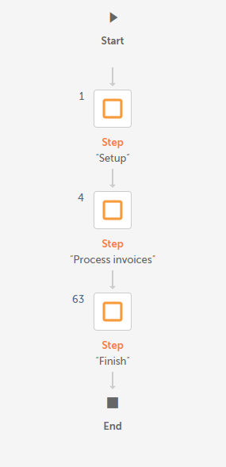
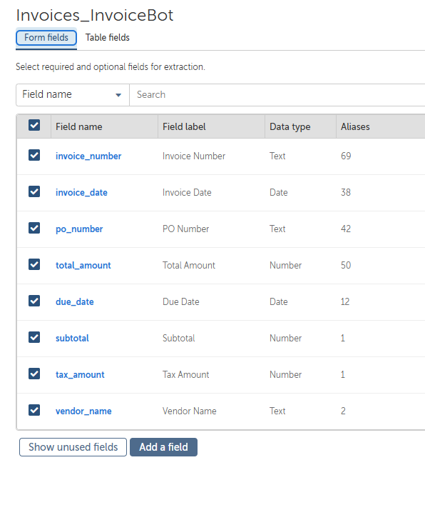
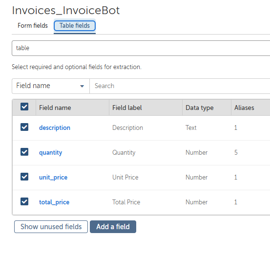
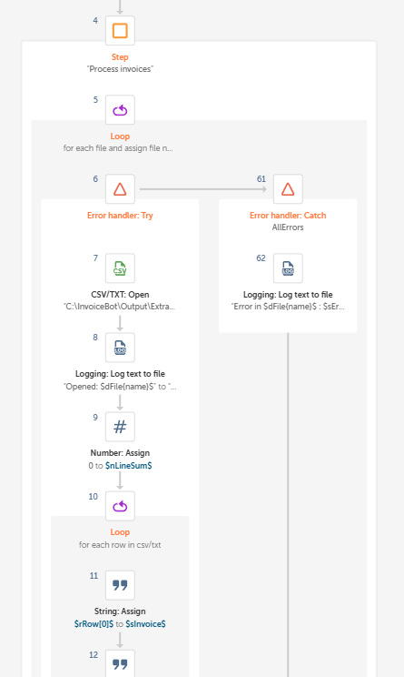
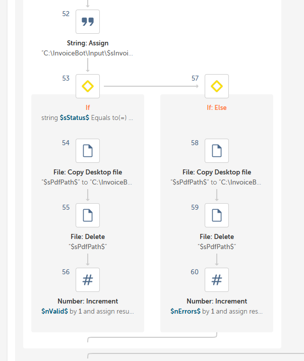
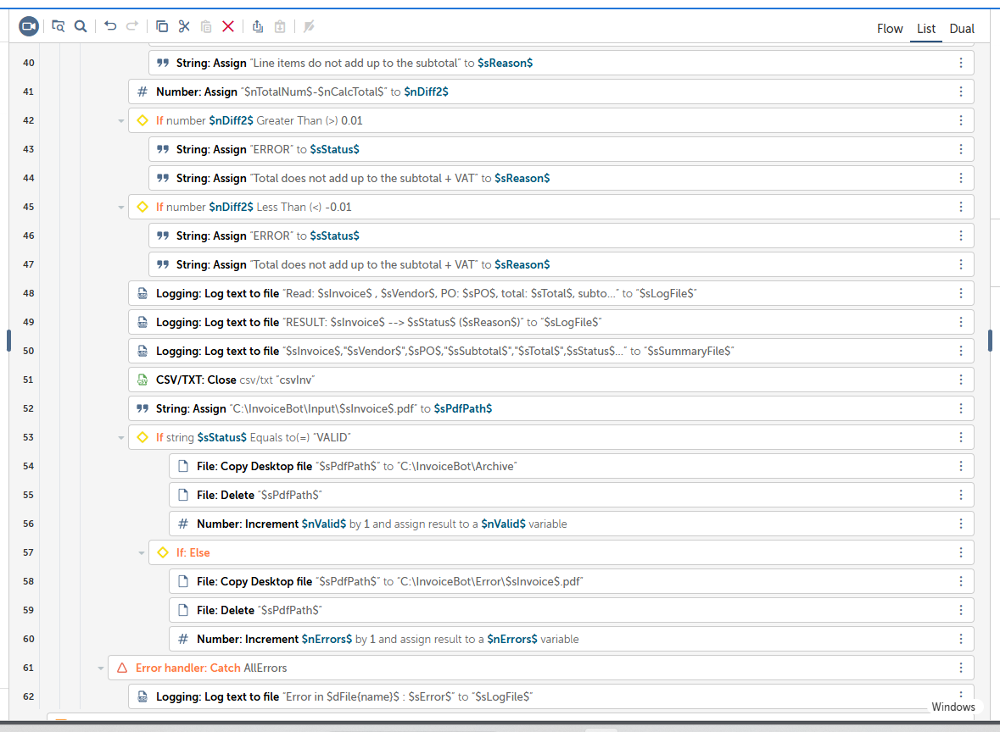
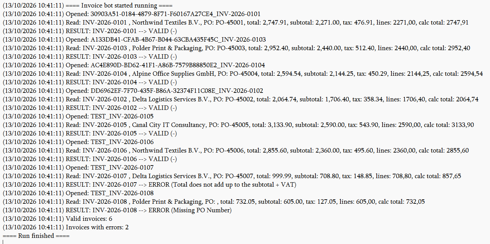
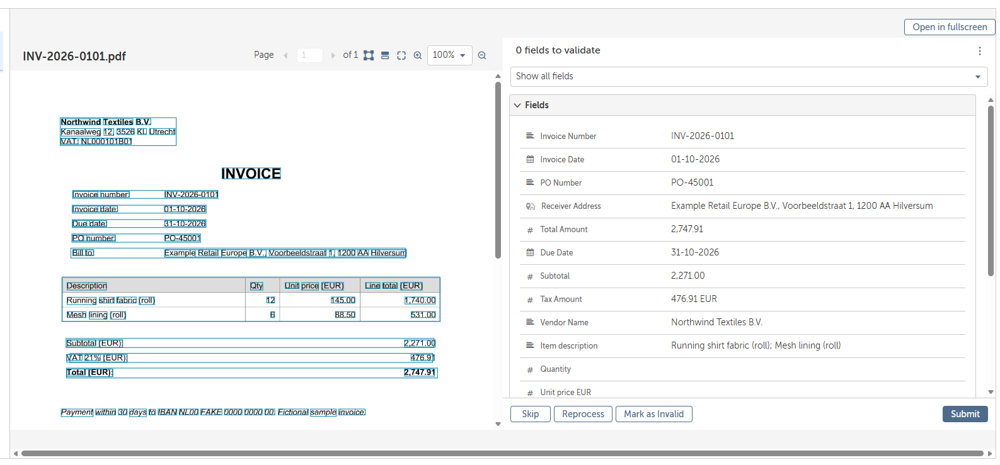

# Invoice Processing Bot – Automation Anywhere (Automation 360)

An end-to-end **finance automation** built in **Automation Anywhere Automation 360 (Community Edition)**: invoices are read with
**Document Automation (intelligent OCR)**, every invoice is **validated against business rules**, valid invoices are archived and
logged to a summary file, and invalid ones are routed to an error folder with the reason, all with error handling and an audit log.

It's a classic **procure-to-pay (P2P)** use case: the step between "an invoice arrives" and "it can be booked".



🎬 **Demo:** [watch the bot process 8 invoices](media/demo_run.mp4): Input → Run → Archive / Error → summary and log.

---

## What it does

```
 Invoice PDFs ──► Document Automation (OCR) ──► one CSV per invoice
                                                      │
                                                      ▼
                         InvoiceBot_Main (Task Bot, Automation 360)
                         ├─ 1. Setup     start log, fresh summary file
                         ├─ 2. Process   for each extracted invoice:
                         │     Try
                         │       read header fields + line items
                         │       clean amounts ("2,747.91" → 2747.91)
                         │       validate (3 business rules)
                         │       write a line to Invoices_Summary.csv
                         │       VALID → PDF to Archive   ERROR → PDF to Error
                         │     Catch
                         │       log the error, leave the file untouched
                         └─ 3. Finish    log counts (valid / errors)
```

**Result on the 8 sample invoices:** 6 valid → `Archive`, 2 invalid → `Error`, each with the correct reason.

| Invoice | Expected | Bot result |
|---|---|---|
| INV-2026-0101 … 0106 | valid | ✅ VALID → Archive |
| INV-2026-0107 | stated total (999.99) ≠ subtotal + VAT (857.65) | ✅ ERROR: *Total does not add up to the subtotal + VAT* |
| INV-2026-0108 | no PO number | ✅ ERROR: *Missing PO Number* |

---

## 1. Extraction: Document Automation (intelligent OCR)

A learning instance (`Invoices_InvoiceBot`) extracts two kinds of fields:

| Form fields (once per invoice) | Table fields (one per line item) |
|---|---|
| invoice_number, invoice_date, due_date, po_number, vendor_name, subtotal, tax_amount, total_amount | description, quantity, unit_price, total_price |

| | |
|---|---|
|  |  |

The output is one CSV per invoice: one row per line item, with the header fields repeated
(example: [`extraction_output_example/`](extraction_output_example/)).

## 2. The bot: InvoiceBot_Main

| | |
|---|---|
|  |  |

**Validation rules** (all in the bot, not in the OCR step, so extraction and business logic stay separate):
1. **PO number present:** `po_number` must contain `PO-`.
2. **Line items add up:** `sum(line totals) = subtotal`.
3. **Totals add up:** `subtotal + VAT = total`.



**Outputs**
- `Archive\` and `Error\` folders with the routed PDFs
- `Invoices_Summary.csv`: one row per invoice with amounts, status and reason
- `InvoiceBot_log.txt`: timestamped audit trail of every step

`Invoices_Summary.csv` after a run:

| invoice_number | vendor | po_number | subtotal | tax | total | status | reason |
|---|---|---|---|---|---|---|---|
| INV-2026-0101 | Northwind Textiles B.V. | PO-45001 | 2,271.00 | 476.91 | 2,747.91 | VALID | - |
| INV-2026-0102 | Delta Logistics Services B.V. | PO-45002 | 1,706.40 | 358.34 | 2,064.74 | VALID | - |
| INV-2026-0103 | Polder Print & Packaging | PO-45003 | 2,440.00 | 512.40 | 2,952.40 | VALID | - |
| INV-2026-0104 | Alpine Office Supplies GmbH | PO-45004 | 2,144.25 | 450.29 | 2,594.54 | VALID | - |
| INV-2026-0105 | Canal City IT Consultancy | PO-45005 | 2,590.00 | 543.90 | 3,133.90 | VALID | - |
| INV-2026-0106 | Northwind Textiles B.V. | PO-45006 | 2,360.00 | 495.60 | 2,855.60 | VALID | - |
| INV-2026-0107 | Delta Logistics Services B.V. | PO-45007 | 708.80 | 148.85 | 999.99 | **ERROR** | Total does not add up to the subtotal + VAT |
| INV-2026-0108 | Polder Print & Packaging | *(empty)* | 605.00 | 127.05 | 732.05 | **ERROR** | Missing PO Number |

The run log (timestamped audit trail):



### Full bot structure (InvoiceBot_Main)

The Community Edition can't export bots, so here is the complete action list, which is enough to rebuild the bot.

```
Step 1 · "Setup"
  Log text to file  $sLogFile$      "==== Invoice bot started running ===="   (timestamp)
  Log text to file  $sSummaryFile$  "invoice_number,vendor,po_number,subtotal,tax,total,status,reason"   (overwrite)

Step 2 · "Process invoices"
  Loop  for each file in folder  C:\InvoiceBot\Output\Extract\Success  → $dFile$
    Error handler: Try
      CSV/TXT: Open      session "csvInv"  C:\...\Success\$dFile{name}$.csv   (header, comma)
      Log text to file   "Opened: $dFile{name}$"
      Number: Assign     0 → $nLineSum$
      Loop  for each row in CSV/TXT "csvInv"  → $rRow$
        String: Assign   $rRow[0]$ → $sInvoice$     $rRow[7]$ → $sVendor$     $rRow[2]$ → $sPO$
                         $rRow[3]$ → $sTotal$       $rRow[5]$ → $sSubtotal$   $rRow[6]$ → $sTax$
        String: Replace  "," → "" in $rRow[11]$ (line total) → $sTemp$
        String: To number  $sTemp$ → $nLine$
        Number: Assign   $nLineSum$ + $nLine$ → $nLineSum$
      String: Replace + To number   $sTotal$ → $nTotalNum$ · $sSubtotal$ → $nSubtotal$ · $sTax$ → $nTax$
      Number: Assign     $nSubtotal$ + $nTax$ → $nCalcTotal$
      Number: To string  $nCalcTotal$ → $sCalcTotal$ · $nLineSum$ → $sLineSum$   (for logging)

      String: Assign     "VALID" → $sStatus$ · "-" → $sReason$
      Rule 1  If $sPO$ does not include "PO-"            → "ERROR" / "Missing PO Number"
      Rule 2  Number: Assign $nSubtotal$ − $nLineSum$ → $nDiff1$
              If $nDiff1$ > 0.01  or  If $nDiff1$ < −0.01  → "ERROR" / "Line items do not add up to the subtotal"
      Rule 3  Number: Assign $nTotalNum$ − $nCalcTotal$ → $nDiff2$
              If $nDiff2$ > 0.01  or  If $nDiff2$ < −0.01  → "ERROR" / "Total does not add up to the subtotal + VAT"

      Log text to file   "Read: $sInvoice$, $sVendor$, PO: $sPO$, total … lines: $sLineSum$, calc total: $sCalcTotal$"
      Log text to file   "RESULT: $sInvoice$ --> $sStatus$ ($sReason$)"
      Log text to file   → $sSummaryFile$   $sInvoice$,"$sVendor$",$sPO$,"$sSubtotal$","$sTax$","$sTotal$",$sStatus$,"$sReason$"
      CSV/TXT: Close     "csvInv"

      String: Assign     C:\InvoiceBot\Input\$sInvoice$.pdf → $sPdfPath$
      If $sStatus$ = "VALID"
        File: Copy desktop file  $sPdfPath$ → C:\InvoiceBot\Archive
        File: Delete             $sPdfPath$
        Number: Increment        $nValid$
      Else
        File: Copy desktop file  $sPdfPath$ → C:\InvoiceBot\Error\$sInvoice$.pdf
        File: Delete             $sPdfPath$
        Number: Increment        $nErrors$
    Error handler: Catch (AllErrors → $sError$)
      Log text to file   "Error in $dFile{name}$ : $sError$"

Step 3 · "Finish"
  Number: To string  $nValid$ → $sCount$    Log text to file  "Valid invoices: $sCount$"
  Number: To string  $nErrors$ → $sCount$   Log text to file  "Invoices with errors: $sCount$"
  Log text to file   "==== Run finished ===="
```

**Variables** (prefix = type: `s` String, `n` Number, `r` Record, `d` Dictionary):
`sLogFile`, `sSummaryFile`, `dFile`, `rRow`, `sInvoice`, `sVendor`, `sPO`, `sTotal`, `sSubtotal`, `sTax`, `sTemp`,
`nLine`, `nLineSum`, `nTotalNum`, `nSubtotal`, `nTax`, `nCalcTotal`, `sCalcTotal`, `sLineSum`, `sStatus`, `sReason`,
`nDiff1`, `nDiff2`, `sPdfPath`, `nValid`, `nErrors`, `sCount`, `sError`.

**Folder layout on the Bot Runner (Windows):**
```
C:\InvoiceBot\
├── Input\                    invoice PDFs to process
├── Archive\                  valid invoices (after the run)
├── Error\                    invalid invoices (after the run)
├── Logs\InvoiceBot_log.txt   audit log
└── Output\
    ├── Extract\Success\      Document Automation output CSVs (the bot reads these)
    └── Invoices_Summary.csv  results summary
```

---

## Design decisions

- **Copy, then delete, inside Try/Catch.** The File package in this edition has no "move", so each move is copy + delete. If the
  copy fails, the bot jumps to Catch *before* deleting, so **no invoice can be lost**. (This was proven in testing: with the
  Error folder missing, the two invalid PDFs simply stayed in Input and the error was logged.)
- **Tolerance on money comparisons (±0.01).** Decimals are stored with tiny floating-point errors, so totals are compared
  with a tolerance instead of exact equality.
- **Cleaning before converting.** Amounts arrive as text with thousands separators ("2,747.91"); commas are stripped before
  *String: To number*. The bot also runs on a Windows machine with European number formatting (decimal comma), so values
  are converted explicitly rather than relying on defaults.
- **Business rules in the bot, not in OCR.** The PO number is *not* a required field in the learning instance, so a missing PO
  passes extraction and is caught by the bot with a clear reason, instead of silently blocking in validation.
- **Structured with Steps and a full audit log**, so a finance stakeholder can follow what happened to every invoice.

## Lessons learned

- **Form fields vs table fields matter.** In the first run, line-item fields were *also* defined as form fields, so the
  OCR joined both rows into one value ("12;6"). Only the *Quantity* field flagged it (a number type), while *Description*
  silently accepted the merged text. Removing them from the form fields fixed it, and documents then went straight through.

  
- **Field types are the first line of defence:** typed fields (Number, Date) catch extraction errors that text fields hide.
- **Fail safe, not silent:** copy-then-delete plus Try/Catch turned a missing folder into a logged error instead of lost data.

---

## Repository contents

| Path | What it is |
|---|---|
| `sample_invoices/` | 8 **fictional** invoice PDFs (all companies, addresses and numbers are made up) |
| `generate_invoices.py` | generates the sample invoices (Python + ReportLab), incl. 2 deliberately invalid ones |
| `expected_results.csv` | answer key: expected values and status for every invoice |
| `extraction_output_example/` | a real Document Automation output CSV (INV-2026-0101) |
| `test_extracts/` | test CSVs in the identical extraction format (see note below) |
| `make_test_extracts.py` | builds the test CSVs from the same invoice definitions |
| `screenshots/` | bot, learning instance, validator, outputs and log |

## Honest notes and limitations

- **Community Edition limits:** uploads are limited to 4 documents per batch, and extraction requests started failing after the first
  runs (most likely the free quota). Invoices 0101–0104 were extracted by Document Automation. For 0105–0108, **test CSVs in
  exactly the same format** were used to build and test the bot (`TEST_INV-2026-0101.csv` was verified to be identical to the
  real Document Automation output). The bot logic does not change when real extractions replace them.
- **Extraction is triggered from the Document Automation UI** in this version; the bot processes its output folder.
- **Bot export (Bot Lifecycle Management) isn't available** in the Community Edition, so the bot is documented through screenshots and the
  structure above rather than an export file.

## Next steps

- Trigger extraction from the bot itself and run it on a schedule or folder trigger
- Move processed CSVs to a `Processed` folder (idempotent reruns)
- Email a summary to the finance team; write results to Excel
- Store any system credentials in the **Credential Vault** once the bot posts to an ERP

---

*Built by Jaka Kranjc, Automation Anywhere Certified Essentials Automation (Automation 360).*
